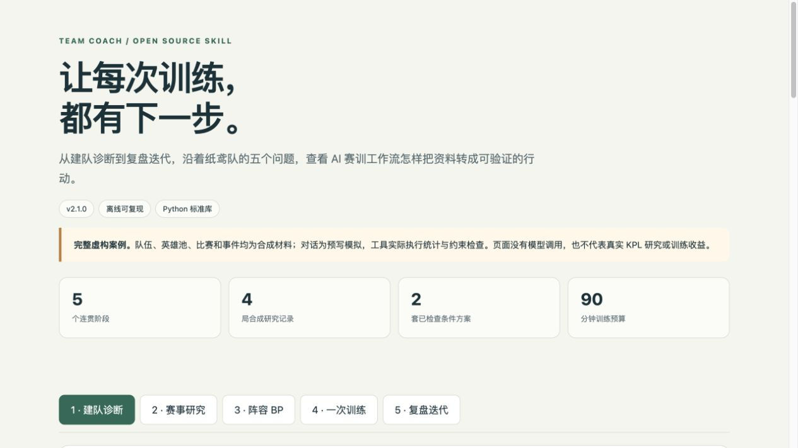

# 塔罗王者赛训

**把队伍的问题，转成下一次能执行、能验证的训练。**

王者荣耀 AI 赛训 Skill，服务队长、队员、教练和分析人员。既能从零安排组队，也能只研究一个英雄组合、准备一次 BP、安排一晚训练，或复盘一段文字记录。适用于支持 Agent Skills 的客户端，配套工具仅依赖 Python 标准库。

当前公开版 **2.1.0**，基于 2.0 通用赛训需求独立编写发布材料和工具。名称中的“塔罗”是个人命名，分析使用规则、证据和队伍记录。

**联系：`puddingvoid`** · [MIT 许可](LICENSE) · [五阶段完整 demo](examples/question-chain/README.md) · [验证说明](docs/validation.md)

[在线演示](https://songliv66.github.io/tarot-wangzhe-team-coach/) · [Demo 页面源码](docs/index.html)



## 能解决哪些问题

| 环节 | 输入 | 你会得到 |
|---|---|---|
| 建队与诊断 | 目标、人员、位置、出勤和协作现状 | 先补人还是先磨合的判断、暂定分工、试打观察和下一步 |
| 赛事与打法研究 | 问题、赛事范围或原始讲解链接 | 有样本与出处的发现、适用条件、待核验项和本队试练方法 |
| 阵容与 BP | 本队英雄池、规则、已知禁选或已用英雄 | 主方案、五位置职责、禁抢替代和后续局英雄储备检查 |
| 一次训练 | 瓶颈、到场人数、可用时长 | 有负责人、观察指标、停止点和缺员预案的安排 |
| 复盘与迭代 | 录像片段、时间戳或文字回忆 | 事实／自述／分析分开，关键替代选择和下次验证项 |

已有稳定安排直接沿用，只补影响当前决定的信息。娱乐队、业余备赛和有既定体系的高水平队，可选择不同深度；不强制完整问卷、建档或 BO3。

## 三分钟跑通离线 demo

需要 Python **3.9+**，无需账号、模型 API Key 或第三方 Python 包。在克隆后的仓库根目录运行：

```sh
git clone https://github.com/songliv66/tarot-wangzhe-team-coach.git
cd tarot-wangzhe-team-coach
python3 scripts/run_demo.py --out demo-output
```

打开 `demo-output/index.html`，可切换五个阶段，阅读输入提示词、示例答复以及工具实际计算的结果。输出目录必须不存在，避免覆盖自己的资料。

这个演示使用完全虚构的“纸鸢队”，展示一条连续的问题链：

1. 五位置已经覆盖，但有双指挥和到场确认缺口，先做磨合观察。
2. 分析四局合成记录，演示如何区分同队共现、样本胜负与战术假设；不冒充当前 KPL 研究。
3. 为三局条件方案准备英雄储备；第一局张飞被禁后，第一局换牛魔，第二局同步换太乙真人。
4. 安排 90 分钟训练，给出缩短到 60 分钟及缺一人的调整。
5. 复盘虚构的时间戳文字事件，把问题收束为下一次两项可观察的验证。

**五段对话是预写模拟案例，离线演示器负责校验、统计和排版；它不会偷偷调用模型，也不证明真实训练收益。** 将同一提示词提交给自己的 AI 客户端，才是实际 Skill 对话使用。

单独体验配套工具：

```sh
python3 scripts/coachkit.py analyze examples/question-chain/research-games.json --team 纸鸢队
python3 scripts/coachkit.py check-bp examples/question-chain/scenario.json
python3 scripts/coachkit.py train --minutes 90
python3 -m unittest discover -s tests -v
```

## 在 AI 客户端里使用

本仓库根目录就是一个完整 Skill：`SKILL.md` 是入口，`references/` 是按需指导，`scripts/` 是可选工具。将整个目录放到客户端支持的技能目录，或按客户端的本地 Skill 导入方式安装。不要只复制 SKILL.md。

例如支持共享 Agent Skills 目录的客户端，可以将本仓库克隆为 `~/.agents/skills/tarot-wangzhe-team-coach`。若同名目录已有内容，先确认你要保留哪个版本，不用本示例覆盖旧安装。`agents/openai.yaml` 是可选界面配置。

调用示例：

```text
使用 $tarot-wangzhe-team-coach。
我们是已有五人队，每周能练两晚，每次90分钟。
大家的位置基本稳定，但集合前经常没有确认人是否能到，撤退时也会同时出现不同指令。
请先判断最值得解决的协作问题，安排下一次磨合，并给出观察指标。
```

完整的五类可复制提问和连续示例见 [Demo 目录](examples/question-chain/README.md)。你可以只使用其中任意一类。

## 怎样使用赛事资料

优先查看 [腾讯 KPL 官网](https://kpl.qq.com/)、[赛事数据平台](https://datamore.qq.com/project/wzmatch/dist/index.html)及主办方公告。第三方原始讲解要核对作者、日期、版本、具体片段与论据；没有读到内容就保留研究缺口。

实验性网页接口读取器可按明确范围尝试采集；网络命令与归一化输入格式见 [工具说明](docs/tools.md)。公开网页接口不保证长期可用，无 API Key 也不表示数据拥有统一再分发许可。工具只在你显式执行网络命令时联网；离线 demo 和测试不联网。

抓取时间、比赛时间和游戏版本分别记录。官方接口失败后，继续处理本队资料支持的训练或条件方案；不把合成文件、历史成功或旧缓存写成新的官方发现。

## 输出是什么

Skill 对话可以交付自然语言方案、简表和待验证任务。工具输出 JSON；完整 demo 输出独立 HTML、Markdown 与计算结果，能在本地查看，也能作为教学说明。队伍负责实际报名、沟通和训练，AI 不自动读取私人战绩或替队伍参加比赛。

约束校验只回答“这些输入是否满足已声明的条件”。英雄熟练度、本队实力、当前机制和正式比赛合法性仍需要真实资料。少量样本的共现或胜率不等于最强阵容，也不承诺上分与比赛成绩。

## 工程与验证

- Python 标准库工具，无隐式模型调用和默认联网。
- 相同的合成输入可以重跑；错误输入应明确失败。
- 测试覆盖同队／敌方统计隔离、重复与不完整记录、BP 跨局冲突、禁用分支、训练时长与失败写入等边界。
- 附 GitHub Actions [配置示例](docs/ci-example.yml)，可手动启用离线测试及 demo；当前已验证环境和实际测试数量以 [验证记录](docs/validation.md) 为准。

浏览页面只帮助阅读，不自动计算战术优劣。与模型的实际对话能力、脚本逻辑、网络可用性和真实队伍收益分别验收。

## 来源 许可 与维护

公开包的文档、工具和合成案例由维护者按通用赛训需求独立编写，采用 MIT。腾讯、王者荣耀及英雄名称归相应权利人；外部数据、视频和规则按各自权利使用。[来源说明](NOTICE.md)

首次发布范围是五类工作流、标准库工具和合成 demo。欢迎通过 Issue 提交可复现问题与脱敏输入，通过 PR 改进规则检查、文档或客户端适配。个人项目按可用时间维护，不承诺持续在线服务或响应时限。

**联系：`puddingvoid`**。请不要在公开 Issue 附上队员手机号、账号凭证、私人录像或未获授权的资料。
